<a href="https://github.com/eiffis">
  <picture>
    <source media="(prefers-color-scheme: dark)" srcset="./dark_mode.svg">
    
  </picture>
</a>

## `0x01` Flagship firmware

<a href="https://github.com/eiffis/Mini-Sonar">
  <picture>
    <source media="(prefers-color-scheme: dark)" srcset="./assets/sonar_dark.svg">
    
  </picture>
</a>

<table>
  <tr>
    <td width="300">
      
    </td>
    <td>
      <b><a href="https://github.com/eiffis/Mini-Sonar">Mini-Sonar</a></b>: a real-time ultrasonic radar on STM32F429.<br><br>
      The servo and HC-SR04 drivers talk directly to the CMSIS registers, with no HAL.<br><br>
      Echoes are timed by TIM2 input capture at 1&nbsp;µs resolution, while LTDC streams an SDRAM framebuffer to the onboard LCD.
    </td>
  </tr>
</table>

## `0x02` Pinout

<picture>
  <source media="(prefers-color-scheme: dark)" srcset="./assets/pinout_dark.svg">
  
</picture>

## `0x03` Memory map

| Address | Project | What it does | Stack |
| :-- | :-- | :-- | :-- |
| `0x0800_0000` | **[Mini-Sonar](https://github.com/eiffis/Mini-Sonar)** | Real-time ultrasonic radar | `C` `STM32` `CMSIS` |
| `0x2000_0000` | **[Zappy](https://github.com/eiffis/Zappy)** | Multiplayer network game with a TCP server, 3D client and AI swarm (team project) | `C++20` `OpenGL` `Python` |
| `0x4000_0000` | **[Arcade](https://github.com/eiffis/Arcade)** | Game platform loading games and renderers as shared libraries (team project) | `C++` `SDL2` `SFML` `ncurses` |
| `0x6000_0000` | **[myFtp](https://github.com/eiffis/myFtp)** | FTP server handling multiple clients with `poll` | `C` `sockets` |

## `0x04` Currently flashing

```text
[ WIP ] ros2_robot ........................ building a ROS 2 robot
```

## `0x05` Open a serial port

[LinkedIn](https://www.linkedin.com/in/enzoiffis) · [Email](mailto:iffisenzo10@gmail.com) · Discord: `xeskos`

<picture>
  <source media="(prefers-color-scheme: dark)" srcset="./assets/footer_dark.svg">
  
</picture>
